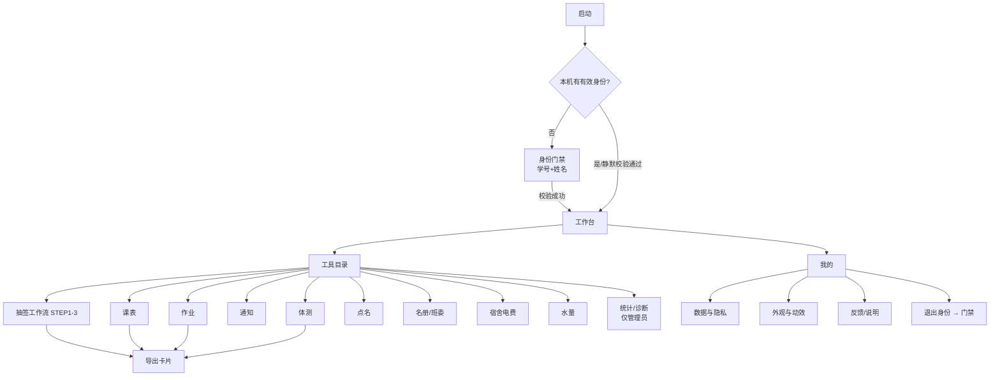
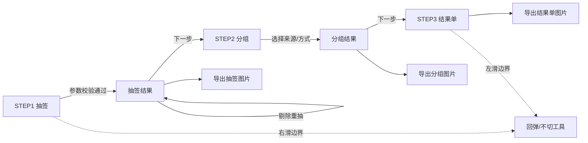
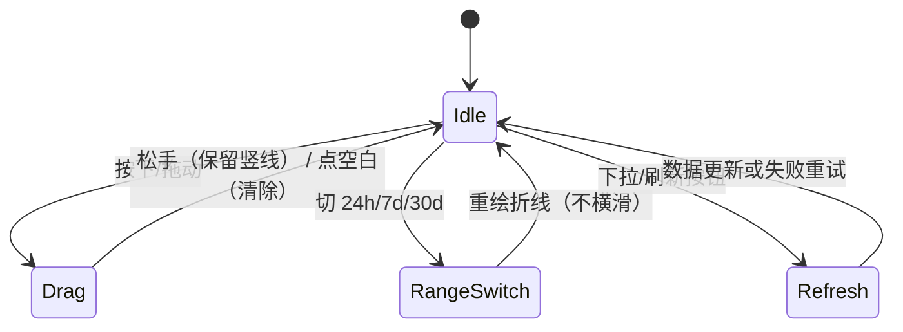

# 逐页原生方案（Screens Spec）
### 班级工具站 Android 原生 App · `android-class-tools/design/SCREENS.md`

> 配套：`ANDROID17_DESIGN.md`（设计语言）、`tokens.json`、`COMPONENTS.md`（Compose API/版本）。
> 数据契约以后端文档 `android-class-tools/docs/BACKEND_CONTRACT.md` 为准（由 task-3 产出）；本文只定义 **UI 结构 / 状态 / 动效 / 自适应 / 兜底**。
> 标注：`原生=推荐原生实现`、`WebView=建议 WebView 兜底`、`⚠️未核实` 表示后端字段待契约确认。

---

## 0. 信息架构与导航

### 0.1 目的地（3 个一级 + 工具二级）
| 一级 | 二级/入口 | 说明 |
|---|---|---|
| 工作台（Home） | 今日课程、电费关注、作业待交、通知待处理、常用工具（≤4）、全部工具 › | 进入后即用（身份通过后）；对应小程序 `pages/index` |
| 工具（Tools） | 工具目录（长按拖动排序、编辑首页勾选、搜索）、抽签分组、课表、作业、通知、体测、点名、班委、名册、电费、水量、统计*/诊断*（*仅管理员） | 对应小程序 `pages/all` + web「全部」；工具打开为二级页面 |
| 我的（Me） | 身份卡、我的数据、云同步、数据与隐私、反馈建议、使用说明、退出身份 | 对应小程序 `pages/me` + `pages/data` |

> 说明：web 的「顶部 3/4 格工具切换条、无底部导航」是网页红线；**Android 端采用 M3 自适应导航**（compact=底部导航 / medium=侧栏 / expanded=宽侧栏）。若产品要求 1:1 复刻 web 顶部工具条，则 compact 用 `PrimaryTabRow` 固定 3 工具 + 「全部」并保留左滑切工具手势（备选，见 §2.3）。

### 0.2 自适应策略总表
| 页面 | compact（<600dp） | medium（600–839dp） | expanded（≥840dp） |
|---|---|---|---|
| 身份门禁 | 居中单卡 400dp | 左品牌区 + 右表单卡 | 左品牌区（含班级信息/品牌图形）+ 右表单卡（最大 440dp） |
| 工作台 | 单列卡片流 | 2 列卡片网格 | 3 列卡片网格 + 侧栏导航；内容最大宽 1200dp |
| 工具目录 | 2 列卡片 | 3 列 | 4 列（≥1200 可 5 列）；拖动跨列 |
| 抽签 STEP1-3 | 单列 + 底部动作条 | 左配置 5 / 右结果 7 分栏 | 6/6 分栏 + 步骤条常驻顶部 |
| 体测 | 表单卡 + 评分卡（纵向） | 左表单 / 右评分分栏 | 左表单 / 中间评分 / 右历史 三栏 |
| 作业 | 单列列表 | 2 列卡片 | 列表-详情双栏（列表 380dp + 详情） |
| 通知 | 单列 + 详情全屏 | 2 列卡片 | 列表-详情双栏；详情可能是 WebView |
| 课表 | 周视图横向可滚（7 列最小宽 44dp/列） | 周视图 + 右侧 next/课程列表 | 主区 + 侧栏（参考 web 桌面：主区+侧栏，无下一节时单栏全宽） |
| 电费 | hero 卡 + 趋势卡 + tiles（纵向） | hero 左 / 趋势右 | 三栏（hero / 趋势 / tiles） |
| 水量 | hero→新增→历史→规则（纵向） | 2 栏（hero+表单 / 历史+规则） | 3 栏（hero / 表单+规则 / 历史） |
| 点名 | 单列网格（4 列姓名） | 6 列 | 8 列 + 统计吸顶 |
| 名册/班委 | 单列 | 2 栏 | 2–3 栏 |
| 设置/数据 | 单列 | 内容最大宽 720dp 居中 | 左导航列表 / 右内容（720dp） |
| 导出预览 | 单列 | 居中卡片 + 右侧操作 | 居中卡片 + 右侧操作/历史 |

### 0.3 全局状态模式
| 状态 | 规范 |
|---|---|
| 首屏加载 | 骨架屏（形状/数量与真实内容一致），**不用全屏 spinner**；骨架 shimmer 1.2s |
| 局部加载 | 卡片内骨架或 16dp 内联 spinner；保留旧值不闪 0 |
| 空 | `EmptyState`：图标 + 标题（titleMediumEmphasized）+ 一句说明 + 一个动作（如「打开课表」「去选择名单」） |
| 错误 | `EmptyState` 错误版：原因分类（网络/身份过期/服务不可用/解析失败）+「重试」；网络错误显示「已显示本机缓存」或「离线可用」 |
| 离线 | 顶部 `AssistChip`（info 色）「离线 · 显示本机缓存」；可写操作排队（marks/UD 待补发） |
| 同步 | 统一 `SyncStatusChip`：已同步（success）/同步中（info，带 16dp spinner）/待补发 N（warning）/仅本机（neutral） |
| 权限 | 通知权限被拒 → 设置页「提醒」行显示「已关闭 · 去开启」引导系统设置 |
| 破坏性操作 | `AlertDialog` 二次确认（红字描述后果）+ 主按钮 danger；不做 undo 的删除必须确认 |
| 返回 | 弹层/Dialog 打开时返回先关弹层；工作流内返回上一步；根页双击返回退出（第一次 Snackbar 提示） |

### 0.4 原生 vs WebView 兜底总建议
| 内容 | 建议 | 理由 |
|---|---|---|
| 身份门禁 | **原生** | 安全/autofill/键盘/首帧体验；WebView 不可接受 |
| 工作台/工具目录/设置 | **原生** | 纯列表/卡片 |
| 抽签/分组/结果单/体测/课表/电量/水量/点名/班委/名册/作业列表/通知列表/统计/诊断 | **原生** | 交互与性能要求；导出走原生 Canvas |
| **通知详情富文本** | **原生优先；WebView 兜底** | notice 模板是 AI 生成的富 HTML（分点/附件/编辑覆盖）；原生渲染不可控时用 `WebView` 加载「裁剪后的详情 HTML」（只读、禁 JS 桥、禁外链跳转用 `shouldOverrideUrlLoading`） |
| 通知附件预览 | **WebView / 系统 Intent** | PDF/DOC/图片：图片原生 `ZoomableImage`；PDF 用系统 `ACTION_VIEW`；其余 `ACTION_VIEW` + FileProvider |
| 作业正文 | **原生**（`AnnotatedString` + 图片） | 作业内容是纯文本 + 最多 2 附件 |
| 导出图片 | **原生 Canvas** | 版式固定、需要水印/编号 |
| 课表导入的 JSON 解析 | **原生** | 纯解析 |
| 管理员诊断/统计 | **原生** | 列表/状态行 |

---

## 1. 身份门禁（Identity Gate）

**入口**：冷启动（无有效 token）→ 全屏门禁；有 token → 骨架 + 静默校验。**原生**。

### 1.1 布局
```
compact                          medium/expanded
┌──────────────────────┐         ┌───────────────┬─────────────────┐
│        ●●●           │         │  品牌区        │   表单卡 400dp   │
│      班级工具         │         │  (雾青渐变/    │  学号            │
│  2026级信息管理…      │         │   logo/码点)   │  姓名            │
│ ┌──────────────────┐ │         │  班级名/版本    │  [进入班级]      │
│ │ 学号 [__________]│ │         │               │  错误行          │
│ │ 姓名 [__________]│ │         │               │  隐私说明/版本    │
│ │ [   进入班级   ] │ │         └───────────────┴─────────────────┘
│ │ 错误行           │ │
│ └──────────────────┘ │
│ 仅本班同学可进入…    │
└──────────────────────┘
```
- 品牌标识：3 个品牌圆点（雾青/灰蓝/暖沙）+ 「班级工具」`headlineMediumEmphasized`；副标题「2026级信息管理与信息系统 · 身份进入」`bodyMedium` `onSurfaceVariant`。
- 表单：`OutlinedTextField` 学号（`KeyboardType.Number`、`maxLength 10`、`imeAction Next`、`autofill = Username`）+ 姓名（`imeAction Done`、`autofill = PersonName`）；`singleLine`。
- 主按钮 `Button` 56dp 全宽「进入班级」，校验中显示 16dp spinner + 「验证中…」并禁用。
- 页脚：`bodySmall` 隐私一句话（「仅本班同学可进入；身份校验通过后才加载班级数据」）+ 版本号（唯一来源：`utils/version.js` 的 2.0.0 语义，App 内 `BuildConfig.VERSION_NAME` 与之对齐）。
- 键盘：`windowSoftInputMode=adjustResize` + `Modifier.imePadding()`，确保按钮可见。

### 1.2 状态
| 状态 | UI |
|---|---|
| 初始（无已保存身份） | 表单空，按钮可点（点后校验） |
| 输入中 | 学号非 10 位时按钮禁用 + supporting text「请输入 10 位学号」；姓名空禁用 |
| 校验中 | 按钮 loading；输入禁用；无全屏遮罩 |
| 失败-名单不匹配 | 行内错误（`error` 色）「学号与姓名不匹配，请核对」 |
| 失败-网络/服务 | 行内错误「暂时无法验证，请重试」+ 按钮变「重试」；不丢输入 |
| 已保存身份（30 天 token） | 骨架屏（0.8s 内出结果则不闪门禁） → 直接进工作台；token 过期 → 门禁页 + 「身份已过期，请重新验证」 |
| 测试身份（is_test） | 与正常一致；不显示任何「测试」标识（与小程序行为一致） |

### 1.3 动效
- 页面进入：卡片 `fadeIn + scale 0.96→1`（spatialDefault）+ 品牌区 fade（effectsSlow）；stagger 60ms。
- 错误：输入框描边变 `error` + 轻微水平抖动（±4dp，3 次，effectsFast；可被减弱动效关闭）。
- 成功：卡片 `containerTransform` 到工作台头部（或 sharedAxisX）；**不做**全屏庆祝动画。
- 键盘出现：表单上移（`imePadding` + `animateContentSize`）。

### 1.4 无障碍
- 每个输入有 `label`（不是仅 placeholder）；错误用 `semantics { error(msg) }` + `liveRegion = Politeness.Assertive`。
- 按钮禁用时仍可被 TalkBack 聚焦并朗读原因（「进入班级，学号必须为 10 位」）。
- 自动填充提示：`contentType = ContentType.Username / PersonName`。

---

## 2. 工作台（首页）/ 首页工具切换

**入口**：身份通过后默认页；底部导航「工作台」。**原生**。

### 2.1 布局
```
compact (360dp)
┌────────────────────────────────────┐
│ [身份 chip 姓名▾] [●●●] 班级工具    │  ← 顶部快捷身份/品牌（点击身份 chip → 我的）
│ 早上好，陈同学            role pill │  ← headlineLargeEmphasized + 日期/周次
│ ┌────────────────────────────────┐ │
│ │ 今天               课表 ›      │ │  ← 今日课程卡（elevated）
│ │ 08:00 高等数学 · 3-201          │ │
│ │ 10:00 大学英语 · 2-105  [上课中]│ │
│ └────────────────────────────────┘ │
│ ┌────────────────────────────────┐ │
│ │ 宿舍电费                      › │ │  ← 电费关注卡（outlined）
│ │ 12号楼 305   剩余 86.42 度      │ │
│ │ 更新 10:20  · 预计可用 22 天    │ │
│ └────────────────────────────────┘ │
│ ┌────────────────────────────────┐ │
│ │ 📝 作业待交 3                   │ │  ← 轮播最新一条（5s）
│ │ 数学 · 习题 3.2 · 明天 22:00    │ │
│ └────────────────────────────────┘ │
│ ┌────────────────────────────────┐ │
│ │ 📢 通知待处理 2                 │ │  ← 轮播
│ │ 关于体测安排的通知…             │ │
│ └────────────────────────────────┘ │
│ 常用工具                全部 ›      │
│ [抽签][课表][作业][通知]            │  ← ≤4，编辑模式可换
└────────────────────────────────────┘
   [ 工作台 ]  [ 工具 ]  [ 我的 ]      ← ShortNavigationBar 64dp
```
- 顶部：问候「早上好/下午好/晚上好，{姓名}」`headlineLargeEmphasized`；副行「{MM月dd日} · 第{n}周 · {角色}」`bodyMedium` `onSurfaceVariant`。**不显示学号**。
- 「今日课程」：最多 3 条（时间/课名/地点/「上课中」pill）；无课显示「今天没课 · 下次 {label} {课名}」；课表未同步显示「课表未同步 · 打开课表」（按钮）。
- 电费卡：未选关注宿舍 → 「关注宿舍后显示剩余电量 · 去选择 ›」；已选 → 楼栋房间 + 剩余电量（`displaySmallEmphasized` 数字 + `bodyMedium` 单位）+ 更新时间 + 状态 pill（充足/偏低/低电，用 powerPositive/powerWarn/powerLow）。
- 作业/通知卡：数量 badge + 最新一条轮播（5s 上浮淡出→下浮淡入；**减弱动效时静态显示第一条**）；无数据时显示「作业都完成了」/「暂无待处理通知」。
- 常用工具：≤4 个 `工具tile`（图标 + 名称），右上「全部 ›」；无勾选时显示空态引导「尚未勾选常用工具 · 去工具页勾选（最多 4 个）」。
- 下拉刷新：`PullToRefreshBox` 触发全量同步（marks/UD/今日课程/电费）。

### 2.2 状态
| 状态 | UI |
|---|---|
| loading | 3 个骨架卡（问候行、今日课程、待办） |
| error（首屏） | 错误卡「读取失败 + 原因 + 重试」；不影响底部导航 |
| 部分失败 | 单卡内显示「加载失败 · 重试」，其它卡正常 |
| 离线 | 顶部 info chip「离线 · 显示本机缓存」；轮播与电费显示缓存值 + 「缓存时间」 |
| 无身份 | 正常不会出现（门禁保证）；深链兜底 → 跳门禁 |

### 2.3 首页工具切换（两种方案）
- **方案 A（推荐）**：工作台常用工具 grid + 底部导航「工具」；支持「编辑模式」：点「常用工具」右侧「编辑」（或长按任意 tile 进入）→ tile 显示勾选圈，点选/取消（≤4，第 5 个 Snackbar「最多选 4 个」）→「完成」；结果写 `UD.homeTools`（并行同步）。
- **方案 B（web 复刻，备选）**：顶部横向工具条（`PrimaryTabRow`/自定义 `Surface` 圆角 12dp 容器 + 3 个工具 + 「全部」），左右滑动切工具带「液体」指示器（拖动拉伸、松手 spring 吸附）；自定义顺序 `homeTools` 生效。
- 两方案均保留：工具顺序 = `UD.prefs.toolOrder`；首页勾选 = `UD.homeTools`（≤4，且 `noHome` 的「宿舍电费」不参与、管理员工具不参与）。

### 2.4 动效
- 卡片错峰进入：stagger 40ms，`fadeIn + slideInVertically(12dp)`（spatialDefault/fade effectsDefault）。
- 数字变化（电量）：`animateIntAsState` 数字滚动，≤600ms（effectsDefault）。
- 作业/通知轮播：`AnimatedContent`（slide vertical + fade，effectsDefault）。
- 头像 chip / 身份切换：无动画。

### 2.5 自适应
- medium：2 列网格（今日课程跨列、电费与作业同排、通知与常用工具同排）。
- expanded：3 列；左侧 `WideNavigationRail`；内容最大宽 1200dp 居中；顶部问候行与「全部工具」入口对齐。
- Hero 渐变：仅「今日课程」与「电费」卡使用 low-contrast 品牌渐变，其它用 outlined 卡。

---

## 3. 工具页（全部工具 / 工具目录）

**入口**：底部导航「工具」；工作台「全部 ›」。**原生**。

### 3.1 布局
```
┌───────────────────────────────┐
│ 工具                 [搜索][编辑]│ ← MediumTopAppBar + actions
│ [搜索工具…]                    │ ← SearchBar 折叠条（可隐藏）
│ ┌─────────┐ ┌─────────┐      │
│ │ 抽签    │ │ 课表    │      │ ← 2 列卡片（compact）
│ │ 抽号·分组│ │ 周次·下节│      │
│ └─────────┘ └─────────┘      │
│ ┌─────────┐ ┌─────────┐      │
│ │ 作业板  │ │ 班级通知 │      │
│ └─────────┘ └─────────┘      │
│ ┌─────────┐ ┌─────────┐      │
│ │ 体测    │ │ 点名    │      │
│ └─────────┘ └─────────┘      │
└───────────────────────────────┘
```
- 工具卡：图标 tile（48dp 圆角 16dp，`{tool.tone}` 决定容器色：primaryContainer/secondaryContainer/tertiaryContainer/neutral）+ 名称 `titleMedium` + 一行 meta `bodySmall` `onSurfaceVariant`（如「抽号 · 分组 · 结果单」）；整卡可点。
- 工具清单（与小程序/网页对齐）：抽签分组、课表、作业板、班级通知、体测、点名、班委、名册、宿舍电费（`noHome`）、水量、统计*、诊断*（管理员可见）。
- 排序：**长按 350ms 拖动**（跟手幽灵 + 2 帧落点确认 + 边缘自动滚动），松手写 `UD.prefs.toolOrder`（同步）；拖后抑制 tap。
- 首页勾选：标题栏「编辑」进入编辑模式（tile 显示勾选圈，≤4，`noHome`/admin 不可勾选）；或长按后弹出的「加入首页」菜单（二选一，推荐编辑模式）。
- 管理员工具（统计/诊断）：非管理员不渲染（不占位、不可搜索到）。

### 3.2 状态
| 状态 | UI |
|---|---|
| loading | 工具卡骨架 ×6 |
| 空（理论不发生） | 「暂无可用工具 · 下拉刷新」 |
| 搜索无结果 | 「没有匹配的工具」+ 清空搜索按钮 |
| 云端顺序拉取失败 | 用本机顺序，静默；同步状态 chip 显示待补发 |

### 3.3 动效
- 拖动重排：`animateItem()`（spatialDefault）；ghost 抬起 `scale 1.04 + elev3`（spatialFast）。
- 搜索过滤：列表项 fade + `animateItem`（effectsFast）。
- 进入工具：`containerTransform`（卡片→工具页 Hero）或 sharedAxisX（tool 页无 hero 时）。

### 3.4 自适应
- compact 2 列 / medium 3 列 / expanded 4 列（≥1200dp 5 列）；卡片最小宽 150dp、间隙 12/16dp。
- expanded 时目录可带侧栏（最近使用/全部/管理员分区）。

---

## 4. 抽签工作流（STEP 1–3，含分组 / 结果单）

**入口**：工具 → 抽签分组；工作台常用工具。**原生**。

### 4.1 总体结构
- 顶部 `MediumTopAppBar`「抽签分组」+ 返回；下方 `SegmentedButton` 步骤条：STEP1 抽签 / STEP2 分组 / STEP3 结果单（可点回退；已完成步骤显示完成态 ✓）。
- 内容区 `HorizontalPager`（3 页，手势跟手）；**边界**：STEP1 右滑 / STEP3 左滑 → 弹性回弹（spatialFast），不切换工具（与 web「到边界才切工具」不同：Android 用底部导航切工具）。
- 底部常驻动作条（`Surface`，避让 gesture bar）：STEP1 `[导出图片] [下一步：分组]`；STEP2 `[开始分组] [导出图片] [复制]`；STEP3 `[导出结果单图片] [复制全部]`。
- 参数/结果状态存放在 ViewModel + `SavedStateHandle`（旋转/分屏不丢）。

### 4.2 STEP 1 抽签
```
compact
┌───────────────────────────────┐
│ [STEP1 抽签][STEP2 分组][STEP3]│
│ ┌───────────────────────────┐ │
│ │ 范围 起始 [1] 结束 [70]    │ │
│ │ 抽取个数 [10]              │ │
│ │ 排除序号 [3,7,10-12]       │ │
│ │ 参与名单 (未选择) [选择名单]│ │
│ │ [ ] 允许重复               │ │
│ └───────────────────────────┘ │
│ ┌───────────────────────────┐ │
│ │ 抽签结果                   │ │
│ │  07 张伟  23 李四  45 王五…│ │ ← 数字+姓名 chips，品牌色数字
│ │ [从大到小][从小到大][随机] │ │
│ │ [✓] 剔除后自动重抽         │ │
│ └───────────────────────────┘ │
│ [导出图片]      [下一步：分组] │ ← 底部动作条
└───────────────────────────────┘
```
- 参数卡：范围起始/结束（数字）、抽取个数、排除序号（文本，支持 `3,7,10-12` 语法，实时校验）、参与名单（显示已选人数 + 「选择名单」打开 BottomSheet）、允许重复 Switch。
- 开始抽签（主 CTA 56dp）：校验（结束>起始、个数≤可选池、排除解析）；失败行内错误；成功 → 结果面板展开（高度动画 + 数字滚动，≤600ms；可被减弱动效关闭）。
- 结果：chips（序号 `titleMedium` 品牌色 + 姓名 `bodyMedium`），每项右上「×」剔除；「剔除后自动重抽」勾选时补 1 个；排序三按钮（从大到小/从小到大/随机，spatialFast 重排动画）。
- 名单选择器（BottomSheet，全端共用）：搜索 + 网格气泡（70 人），全选/清空/确定；已选计数；「确定」回填；名单来自云端 class_members（缓存本机）。
- 空结果：显示「—」+ 「设置参数后开始抽签」；结果存在但名单为空时只显示序号。

### 4.3 STEP 2 分组
- 成员来源：`SegmentedButton`「用上一步序号 / 选择名单」；名单模式显示选择器。
- 分组方式：`ExposedDropdownMenuBox`「按组数 / 按每组人数」+ 数字输入（stepper 48dp ± 按钮）；「打乱成员再分组」Switch。
- 结果：两列组卡（`Card` 16dp + 组头「第 i 组 · n 人」`titleSmallEmphasized` + 成员行「序号 姓名」`bodyMedium`）；组卡按行等高；奇数个最后一卡半宽。
- 动作：开始分组（主 CTA）、导出、复制（`Clipboard` + Snackbar「已复制」）。
- 分组结果为空时显示引导；分组数 > 成员数的错误行内提示。

### 4.4 STEP 3 结果单
- 汇总卡：参数配置（只读网格：范围/个数/重复/名单人数/分组方式/组数）+ 「抽签结果」chips 块 + 「分组结果」组卡块 + `剔除重抽记录`（若有剔除/重抽：显示被剔除序号与补抽记录，并生成导出卡二维码）。
- 动作：导出结果单图片（主）、复制全部（`Clipboard`，纯文本版）。
- 导出走 §14。

### 4.5 状态 / 校验 / 边界
| 情况 | 行为 |
|---|---|
| 范围非法（结束<起始） | 行内错误 + 开始按钮禁用 |
| 抽取个数 > 可选池（非重复） | 错误「最多可抽 N 个」+ 自动建议 |
| 排除解析失败 | 错误「格式示例：3,7,10-12」 |
| 抽签中 | 按钮 loading（≤300ms，实际同步计算，加最短 150ms 反馈防闪烁） |
| 名单为空 + 选择名单 | 空态「未选名单，将按序号抽取」 |
| 小组数 > 人数 | 错误行内提示，不弹窗 |
| 旋转/分屏 | ViewModel 保存 step、参数、结果、名单选择（不重新抽） |
| 返回 | STEP3→STEP2→STEP1→工具页；每步 Snackbar 无 |

### 4.6 动效
- STEP 切换：HorizontalPager 跟手 + 松手吸附（spatialFast）；步骤条指示器 morph（effectsDefault）。
- 抽签揭示：数字滚动（`animateIntAsState`）+ chips 交错 fade-in（stagger 30ms，spatialDefault）；总时长 ≤600ms。
- 剔除：chip 缩小消失（spatialFast）+ 其余重排（animateItem）。
- 分组结果：组卡 stagger 30ms；新分组时旧结果 `AnimatedContent` 淡出。

### 4.7 自适应
- medium：左右分栏（左参数 5 / 右结果 7），结果区常驻可见；步骤条在顶部。
- expanded：6/6；左参数+名单，右结果+分组；STEP 页签与结果可同屏（STEP2/3 右侧显示对应结果）。
- 横屏手机（compact 高度）：参数卡收起为「摘要行 + 展开」，结果区占主位。

### 4.8 WebView 兜底：无（纯原生）。名单/结果复制可用系统剪贴板。

---

## 5. 分组与结果单（WORKFLOW 页的独立验收点）
> 归在抽签工作流 STEP2/STEP3（同一路由，共享 ViewModel）。独立验收项：
- 分组结果导出为 `groups` 块（两列组卡），参数含「分组方式/组数或每组人数/打乱」。
- 结果单导出含抽签 chips + 分组 groups + 剔除重抽记录（QR 可选，抽签剔除/重抽存在时生成）。
- 复制文本格式：`第 i 组：07 张伟、23 李四…`，含参数头与生成时间（与导出卡 footer 一致）。

---

## 6. 体测（Fitness）

**入口**：工具 → 体测。**原生**。

### 6.1 布局
```
compact                            medium/expanded
┌──────────────────────────┐      ┌──────────────┬──────────────┐
│ [男][女]  [大一/大二 ▾]  │      │ 表单卡        │ 评分卡        │
│ 身高[  ] 体重[  ]        │      │ (同左)        │ 总分 hero     │
│ 肺活量[ ] 50米[ ]        │      │              │ 项目得分表    │
│ 坐位体前屈[ ] 立定跳远[ ]│      │              │ 历史记录      │
│ 引体向上[ ] 1000米[ ]    │      │              │              │
│ [保存记录][导出][复制]    │      └──────────────┴──────────────┘
│ [国标表][清空]           │
└──────────────────────────┘
┌──────────────────────────┐
│ BMI 22.1 良好 总分 78 良好│ ← 实时评分区（已填项即时出分）
│ 项目  权重  成绩  得分     │
│ …                       │
└──────────────────────────┘
```
- 性别/年级 `SegmentedButton`；7 项输入（数字键盘、单位后缀、小数点步进）；引体向上/仰卧起坐随性别换标签；长跑用「分:秒」双输入。
- 实时评分：任意项变化立即重算单项得分与总分/等级/BMI/附加分（长跑加分）；未填项按 0；全部填完显示总分与等级。
- 历史记录（最多 2 条）：保存记录 → 命名/覆盖；历史列表支持回填、重命名、删除（确认）。
- 国标表：「查看国标表」→ 全屏 Dialog（性别/年级切换 + 表格横向滚动 + 权重说明）。
- 动作：保存记录（主）、导出图片、复制、清空（确认）。

### 6.2 状态
| 状态 | UI |
|---|---|
| 初始 | 表单空，评分区显示「—」，无总分 |
| 部分填写 | 单项得分实时，总分 `bodyLargeEmphasized` + 「未填项按 0 计」 |
| 全部填写 | 总分 + 等级 + 附加分（长跑）+ 与历史对比提示（可选） |
| 保存成功 | Snackbar「已保存」+ 历史列表插入动画 |
| 非法输入 | 行内错误（如「身高应≥100cm」）+ 该项不计分 |
| 历史为空 | 「暂无历史记录 · 保存后最多保留 2 条」 |

### 6.3 动效
- 得分变化：数字滚动（effectsDefault），单行高亮背景 flash（effectsFast 一次）。
- 保存：评分卡 scale 1→1.02→1（spatialFast）+ Snackbar。
- 国标表打开：containerTransform 自「国标表」按钮。

### 6.4 自适应
- medium 左右分栏（表单 6 / 评分 4）；expanded 三栏（表单 / 评分 / 历史）。
- 国标表 expanded 用 Dialog maxWidth 560dp；compact 全屏。
- 横屏：表单 2 列变 3 列（身高体重肺活量一行）。

### 6.5 WebView：无。

---

## 7. 作业（Homework）

**入口**：工具 → 作业板；工作台作业卡。**原生**。

### 7.1 布局
- 顶部 `MediumTopAppBar`「作业」+ actions：[导出清单] [清除已完成]（次要，放 overflow）；管理员/发布者有「发布作业」FAB 或按钮。
- 列表：作业卡（`ListItem`）：科目 + 内容摘要（2 行）+ 截止倒计时（`bodySmall`，临期 `warning` 色）+ 发布者 + 附件数 icon + 完成 Checkbox；已完成：删除线 + 沉底 + `onSurfaceVariant`。
- 点卡片 → 详情页/BottomSheet：完整内容、附件列表（图片缩略图/文件行）、发布者/时间、完成状态、隐藏（仅自己）、删除（发布者/管理员）。
- 发布：BottomSheet 表单（科目、截止日期+时间、内容、截止说明、昵称、最多 2 附件）—— 附件选择系统 Photo Picker / `OpenDocument`；图片按需压缩（≤5MB，与 web 一致）；发布按钮置灰直到必填项齐全。
- 导出清单图片 → §14（文本块）。

### 7.2 状态
| 状态 | UI |
|---|---|
| loading | 骨架列表 ×4 |
| 空 | 「暂无作业」+（有权限）「发布作业」按钮 |
| 错误 | 错误卡 + 重试；保留缓存列表 + 「离线」chip |
| 离线 | 显示缓存；完成勾选本地立即生效，待补发 chip |
| 发布中 | 按钮 loading；失败保留表单内容 |
| 附件预览 | 图片 → 全屏可缩放；PDF/文档 → 系统 Intent 或 WebView |

### 7.3 动效
- 勾选完成：checkbox + 卡片沉底重排（spatialDefault）+ 删除线出现（effectsFast）。
- 发布成功：列表顶部插入（spatialDefault）+ Snackbar。
- 清除已完成：批量淡出（effectsFast）+ 列表收缩。

### 7.4 自适应
- compact 单列；medium 2 列卡片；expanded 列表-详情双栏（列表 380dp + 详情 sticky）。
- 发布表单：compact 全屏 BottomSheet；expanded 右侧 Dialog。

### 7.5 WebView：附件预览可 WebView/系统；正文原生。

---

## 8. 通知（Notices）

**入口**：工具 → 班级通知；工作台通知卡。**列表原生 + 详情原生/WebView 兜底**。

### 8.1 布局
- 顶部：`MediumTopAppBar`「班级通知」+ 筛选（全部/未处理，`SegmentedButton` 或 FilterChip）+ 刷新。
- 列表（按时间倒序，置顶优先）：通知卡：
  - 置顶项左侧 3dp `primary` 竖条 + 「置顶」标签；
  - 标题 `titleMedium`；AI 简报摘要 2–3 行 `bodyMedium`；时间 `bodySmall`；来源/附件/合并标记（`mergedSources` → icon + 「多源合并」；附件 → 回形针 + 数量）；
  - 已处理：标题删除线 + `alpha .6` + 沉底；
  - 操作：点击进详情；长按/滑动 → 「标记已处理 / 置顶」（SwipeToDismissBox 单侧或 ContextMenu）。
- 详情页：
  - 原生部分：标题、时间、来源、AI 要点列表（bullet `bodyLarge`）、附件行（下载/打开）、状态按钮（标记已处理/置顶）、原文折叠区。
  - **富文本正文（notice 模板 HTML）**：优先原生（分点/段落/图片/链接）；若模板含原生难渲染的结构（嵌套表格、特殊样式）→ 切换到 `WebView` 只读渲染裁剪 HTML（禁 JS、禁表单、拦截外链）。
  - 管理员：编辑/隐藏可跳转提示（Android 端不做管理员编辑，V1 只读；编辑仍走 web）。
- 附件：「待获取」状态显示 badge（微信加密图片/QQ 文件缺失，与 web/小程序一致）；可下载项点开 → 系统 Intent。

### 8.2 状态
| 状态 | UI |
|---|---|
| loading | 骨架 ×4 |
| 空 | 「暂无通知」 |
| 错误 | 错误卡 + 重试；离线缓存可读 |
| 已处理 | 沉底 + 删除线；可撤销（Snackbar action「撤销」） |
| 置顶 | 顶部 + 竖条；取消置顶即时重排 |
| 附件不可得 | 「待获取」+ 说明（不显示下载按钮） |
| WebView 失败 | 回退原生「要点 + 原文纯文本」 |

### 8.3 动效
- 标记已处理：卡片变灰 + 下移沉底（spatialDefault）；撤销反向。
- 置顶：卡片上移到顶部（spatialDefault）+ 竖条 fade。
- 详情打开：通知卡 containerTransform → 详情（列表-详情双栏时右侧内容 crossfade）。

### 8.4 自适应
- compact 全屏详情；medium 2 列卡片 + 详情 BottomSheet（90% 高）；expanded 双栏（列表 380 + 详情 WebView/原生）。

### 8.5 WebView 兜底细节
- 仅在「详情正文」使用；`WebView` 设置：`javaScriptEnabled=false`、`allowFileAccess=false`、`domStorageEnabled=false`、`setSupportZoom(true)`；`WebViewClient.shouldOverrideUrlLoading` 拦截外链 → 提示「用浏览器打开」；高度自适应滚动（**不要**套 iframe 方案，原生 WebView 自带滚动）。
- 安全：只加载本地生成的 HTML 字符串（`loadDataWithBaseURL(null, html, "text/html", "utf-8", null)`），不加载远程页面；禁用一切 JS 桥。

---

## 9. 课表（Timetable）

**入口**：工具 → 课表；工作台今日课程卡。**原生**。

### 9.1 布局
```
compact
┌───────────────────────────────┐
│ ‹  第 12 周 · 11/3-11/9  ›  [周|日] │
│ [导出] [导入]            已同步│
│   一    二    三    四    五   │
│ 1 ┌────┐┌────┐┌────┐ …       │
│ 2 │高数 ││英语 ││     │        │
│ 3 └────┘└────┘└────┘        │
│ … （周末无课自动隐藏）        │
│ [下一节] 14:00 大学物理 3-201  │
│ 全部课程 ▾                    │
└───────────────────────────────┘
```
- 周视图：7 列 × 12 节网格，列头星期+日期（今天高亮 `primary`）；课程块按时间跨度合并色块（品牌色系 4 色轮转，文字 `onPrimaryContainer` 等）；时间段可在左侧标出。
- 日视图：单列时间轴（当前时段指示线）。
- 周切换：左右箭头 + 内容区左右滑动（周视图切「上一周/下一周」，日视图切「相邻一天」；跟手，边界回弹；**周/日视图只用 SegmentedButton 点击切换，不滑动** —— 与 web 红线一致）；「本周」按钮在非本周时出现。
- 课程详情：点击课程 → BottomSheet（课名、时间跨度、教室、周次、教师、同名课程合并说明）。
- 全部课程：折叠列表（合并同名课程后按课程名排序）。
- 导入：BottomSheet（粘贴同步码/JSON/发布链接、选择文件、刷新教务）；只读不可编辑课表。
- 侧栏（medium/expanded）：下一节课卡 + 全部课程；无下一节时主区单栏全宽（与 web 桌面一致）。
- 导出：课表图片（文本块：周次/星期/课程/教室）。

### 9.2 状态
| 状态 | UI |
|---|---|
| 未同步 | 空态「课表未同步 · 打开课表拉取」+ 导入按钮 |
| 加载中 | 网格骨架 |
| 加载失败 | 顶部 info 条「课表拉取失败 · 重试」+ 缓存显示 |
| 空周 | 「本周无课」+ 下一周有课提示 |
| 周次越界 | 箭头禁用（首周/末周） |
| 导入失败 | BottomSheet 内错误行（解析失败/链接无效） |

### 9.3 动效
- 切周：内容水平位移跟手 + 松手吸附（spatialFast）；新周课程交叉淡入（effectsDefault）。
- 课程块点击：scale 0.97 + 详情 containerTransform。
- 「上课中」指示：静态高亮 + 脉动小圆点（effectsDefault，减弱动效时静态）。

### 9.4 自适应
- compact：列宽最小 44dp（7 列可横向滚动，带「左右滑动查看完整周」提示——与 web 一致）。
- medium：列宽自适应铺满；右侧 next 卡。
- expanded：主区 + 侧栏（280–320dp）；内容限宽 1520dp。
- 横屏：网格行高压缩（48dp/节）。

### 9.5 WebView：无。

---

## 10. 电费（宿舍电费）

**入口**：工作台电费卡；工具 → 宿舍电费。**原生**。

### 10.1 布局
```
compact
┌───────────────────────────────┐
│ 宿舍电费               [刷新] │
│ 关注宿舍 [12号楼 305 ▾]        │
│ ┌───────────────────────────┐ │
│ │      ◯ 86.42 度            │ │ ← 环形仪表（Canvas）
│ │      预计可用 22 天         │ │
│ │      状态 pill  [充足]      │ │
│ │ 更新 10:20   [已同步]       │ │
│ └───────────────────────────┘ │
│ [!] 剩 12.4 度 · 低于阈值 20  │ ← 低电条（可设阈值）
│ ┌───────────────────────────┐ │
│ │ 近 24h 趋势   [日更][慢更新]│ │
│ │ [24h][7天][30天]           │ │
│ │   ╱╲╱‾‾╲___  ← Canvas 折线  │ │
│ │   点击/拖动显示竖线+气泡     │ │
│ └───────────────────────────┘ │
│ [预估可用][日均用电][充值][计费]│ ← tiles 2×2
└───────────────────────────────┘
```
- 关注宿舍：BottomSheet 列表（楼栋分组 + 搜索）；选中后写 `UD.power.sel`；展示规范「楼栋 + 房间号」（**不显示姓名/学号**，不导出、不分享）。
- Hero：环形仪表（Canvas 圆弧 + 渐变，剩余电量数字 `displayLargeEmphasized`）+ 估算可用天数 + 状态 pill + 更新时间 + 同步 chip。
- 低电条：低于阈值（默认 30 度，可调；阈值随账号同步）显示「剩 X 度 · 去完美校园充值」。
- 趋势卡：24h/7d/30d `SegmentedButton`；Canvas 折线（按真实时间比例铺满，**禁止横向滚动**）；点击/左右拖动命中最近真实采样点 → 竖线 + 圆点 + 气泡（时间 · 电量），气泡优先在指针上方 16dp、放不下翻下、边界 clamp；松手保留，点空白取消；触摸区域 `touch-action` 等价 = Compose `pointerInput` 消费纵向拖动以避免父滚动打断。**慢更新/日更**：按 task-17 契约（13/16 号楼日更：慢频判定 ≤6 次/24h 变化；显示「日更」/「数据更新较慢 · 上次变化 MM-DD HH:MM」/「数据未更新」；估算 tile 标「参考」；30 天无变化提示「近 30 天无变化」）。水费扣减徽标（`water` 记录折算）。
- Tiles：预估可用天数（或「参考」）、日均用电、充值记录（期间有充值）、计费规则（阶梯/单价说明，只读）。

### 10.2 状态
| 状态 | UI |
|---|---|
| 未选择宿舍 | hero 显示「关注宿舍后显示剩余电量」+「去选择」；趋势/tiles 隐藏 |
| 加载 | hero 骨架（圆环占位）+ 趋势骨架 |
| 无数据 | 环显示「—」+「数据积累中」/「数据未更新」提示 |
| 错误 | 卡片内错误 + 重试；保留上次数据 + 「缓存时间」 |
| 慢更新 | 趋势头「日更」chip + 说明行；估算 tile 加「参考」 |
| 有充值 | 趋势卡「期间有充值」标注；阶梯线不插值 |
| 低电 | 低电条 + 状态 pill 换 powerLow |
| 同步失败 | 「已显示本机缓存 · 点此重试」chip |

### 10.3 动效
- 环填充：`animateFloatAsState`（spatialSlow, 0→ratio）一次性；数字滚动。
- 趋势切换区间：折线 morph（`animateFloatAsState` 逐点插值或 crossfade + path 变换，effectsDefault）；**不做横向滑动**。
- 气泡跟手：手势期间直接更新（无动画），松手保留；重排时锚点回落到采样点。
- 刷新：环形 spinner 图标旋转 1 圈（effectsDefault）+ 数据 crossfade。

### 10.4 自适应
- compact：纵向 hero → 趋势 → tiles。
- medium：hero 左（5）/ 趋势右（7），tiles 在趋势下方。
- expanded：三栏 hero / 趋势 / tiles（参考 web 桌面 1280+）。
- 横屏：hero 压缩为横向条；趋势占主区。

### 10.5 WebView：无（Canvas 原生）。隐私：不导出、不分享。

---

## 11. 水量（Water）

**入口**：工具 → 水量；工作台无入口（可勾选进常用工具）。**原生**。

### 11.1 布局
```
compact
┌───────────────────────────────┐
│ 宿舍水量                      │
│ 关注宿舍 [12号楼 305 ▾]        │
│ 宿舍人数 [4人间 ▾]            │
│ 上次抄表   86.42 吨            │
│ 对比：本月 88.10 → +1.68 吨    │
│ ┌───────────────────────────┐ │
│ │ 新增抄表   月份 [2026-11 ▾]│ │
│ │ 读数 [    ] 吨             │ │
│ │ [保存记录]  预览：水费…    │ │
│ └───────────────────────────┘ │
│ 抄表历史                       │
│ 2026-10  85.00 吨  [删除]     │
│ …                             │
│ 计费规则（只读）               │
└───────────────────────────────┘
```
- 关注宿舍（沿用 `UD.power.sel`，未选时提示先选电费关注宿舍或在此直接选）；人数 4/6 人间（免费额度 8/12 吨/月）。
- 上次抄表 + 自动对比（本月读数与上次差值 → 用水量/水费估算）。
- 新增抄表：月份选择 BottomSheet（年切换 + 12 宫格 + 「本月」）、读数 input（两位小数）；保存后历史插入、对比更新；同月重复 → 覆盖确认。
- 计费规则卡：2 吨/人/月免费，超出 3.03 元/吨；水费从电费扣，折合扣电 = 水费 ÷ 0.58；标「以学校最新通知为准」。
- 历史：月份/读数/用量/折算，删除单条（确认）——与 `UD.water` 契约（整段 LWW）。

### 11.2 状态
| 状态 | UI |
|---|---|
| 未选宿舍 | 空态引导「先选择关注宿舍」 |
| 无历史 | 「还没有抄表记录 · 保存第一条」；对比区显示「—」 |
| 输入非法 | 读数 ≤ 上次 或 非数字 → 行内错误；允许小于上次时提示「读数小于上次，请确认」 |
| 保存成功 | Snackbar「已保存」+ 历史插入动画 + 对比更新 |
| 同步 | 统一 SyncStatusChip；离线保存 → 待补发 |

### 11.3 动效：历史插入/删除（spatialDefault）；预览数字变化（effectsDefault）；月份弹层展开（spatialSlow）。
### 11.4 自适应：compact 纵向；medium 2 栏（hero+表单 / 历史+规则）；expanded 3 栏（hero / 表单+规则 / 历史）——与 web 1280+ 三栏一致。
### 11.5 WebView：无。

---

## 12. 名册 / 点名 / 班委

### 12.1 名册（Roster）
- 结构：名单来自云端 `class_members`（缓存），显示「姓名 + 角色/徽章」，**不显示学号**。
- 布局：顶部搜索 + 分组（全部/班委/宿舍可选）；compact 单列（56dp 行）、medium 2 栏、expanded 3 栏。
- 用途：作为抽签/分组/点名的「选择名单」数据源；支持「全选/清空/确定」返回。
- 空态/错误：加载失败 → 重试 + 缓存；名单为空（不太可能）→ 「名单尚未同步」。

### 12.2 点名（Roll）
- 顶部统计条：「应到 N / 已处理 M / 到 X / 假 Y」（`bodyMedium` + pill）。
- 名单设置：沿用抽签名单 / 选择名单 / 重置本轮（确认）。
- 网格：姓名气泡（≥48dp 高，4 列 compact / 6 列 medium / 8 列 expanded）；点「到」或「假」；已处理自动沉底（`animateItem`）并显示状态；再点撤销。
- 状态：未选名单 → 引导；全部处理完 → 顶部 completion 卡「本轮完成 · 到 X / 假 Y · 重置」。
- 动效：处理 → 气泡颜色过渡（effectsDefault）+ 沉底（spatialDefault）；撤销反向。
- 数据：`UD.roster`（名单+到/假）随账号同步；离线可用。

### 12.3 班委（Committee）
- 名单列表：姓名 + 角色 pill + 徽章 pill（无学号、无头像）；管理员可见「管理」（V1 只读，编辑走 web/小程序）。
- 空态/错误/加载同上；布局同「名册」。

---

## 13. 全部工具（Tools 目录）
> 见 §3（工具页）。独立验收：工具目录顺序持久化 `prefs.toolOrder`；首页勾选 `homeTools ≤4`；拖动/编辑模式；管理员工具仅管理员可见。

---

## 14. 设置 / 数据（我的 + 数据与隐私）

**入口**：底部导航「我的」。**原生**。

### 14.1 我的（Me）
```
┌───────────────────────────────┐
│ 身份卡：[姓名首字] 陈同学      │
│ [身份已验证][班长][管理员]      │
├───────────────────────────────┤
│ 我的数据                       │
│ 待交作业 3  已完成 12          │
│ 抽签记录 5  体测记录 1         │
├───────────────────────────────┤
│ 云同步           [已开启  ●]   │
│ 状态：已同步 · 2 分钟前        │
│ [立即同步]                     │
├───────────────────────────────┤
│ [数据与隐私] ›                 │
│ [反馈建议] ›   [使用说明] ›    │
│ [外观与动效] ›                 │
├───────────────────────────────┤
│ [退出身份]（outlined danger）  │
└───────────────────────────────┘
```
- 身份卡：不显示学号/头像；姓名 `headlineSmall` + 状态/角色 pill；点卡进「数据与隐私」。
- 我的数据：4 个指标（待交作业/已完成作业/抽签记录/体测记录）。
- 云同步：Switch（关闭 = 仅本机）、状态行、上次同步、待补发数、「立即同步」按钮（同步中禁用）。
- 入口：数据与隐私、反馈建议、使用说明、外观与动效（**Android 新增**：主题（跟随系统/浅/深）、动态取色（L2）、减弱动效）。
- 退出身份：二次确认（说明「清除本机数据，需重新验证」）；确认后清理本机缓存并回门禁。

### 14.2 数据与隐私（Data）
- 云同步开关 / 状态 / 待补发 / 同步范围 chips（与实现一致的清单）。
- 本机数据概览：存储项/KB + 8 个计数格（已完成作业、已处理通知、置顶、体测记录、抽签/分组/点名名单、待补发）。
- 云端数据说明：userdata/marks/fitrecs 仅本人可读；访问统计/反馈不可删；清除行为=覆盖为空/置否/归档。
- 操作：导出我的数据（JSON，不含 token/名单原文；保存到 `Downloads/班级工具/` 或系统分享）、清除云端我的数据（确认）、清除本机数据（确认，保留身份）。
- 隐私说明：收集/不采集/用途/存储/保留/共享（与小程序文案同源，原生排版为分段列表）。
- 访问统计（仅管理员）：列表-详情双栏（compact 单列）「姓名 · 访问次数 · 最近时间」+ 今天/近 7 天分段。
- 诊断（仅管理员）：状态行列表（18 行/5 组，与云端巡检同口径；`health` 数据由后端提供），异常行 `error` 色 + 展开详情；「刷新」按钮。

### 14.3 状态 / 动效 / 自适应
- 状态：loading 骨架、错误重试、离线 chips、同步中禁用按钮、清除确认 Dialog、导出成功 Snackbar。
- 动效：列表项进入 stagger 40ms；开关切换（effectsFast）；清除成功 → 计数归零数字滚动。
- 自适应：compact 单列；medium 内容最大宽 720dp 居中；expanded 左导航（我的数据/数据与隐私/外观/关于）+ 右内容。
- WebView：无。

---

## 15. 导出卡片（Export Card）

**入口**：抽签/分组/结果单/课表/作业/体测的「导出图片」。**原生 Canvas**。

### 15.1 规格（严格沿用 `web/tools/tests/export_card_v2_spec.md`）
| 项 | 值 |
|---|---|
| 逻辑画布 | W = 760，DPR = 2（成图 1520px 宽，高自适应） |
| 背景 | 垂直渐变 `#EFF4F2 → #F7F8F8`（浅色固定，不随深色主题） |
| 主卡 | 内缩 M=22，圆角 22dp，白底 + 1px 描边 `#E6E9E8` + 阴影（blur 26 / offsetY 8 / rgba(35,48,46,.13)） |
| 内容盒 | X=50，RX=710，CW=660 |
| 头部 | 品牌竖条 4×40dp（primary→primary2 渐变）；3 圆点（primary/secondary/sand）；品牌文字 `tool.furina.fun` 11px/800 ink3；标题 30px/800 ink（超宽降 22 再截断）；副标题 13px/500 ink3；分隔线 |
| 参数配置 | 面板圆角 14dp、`#F4F8F7` 底、1dp `#E8EEEC`；行标签 12.5px/500 ink3，值 14px/600 ink2，行高 21；两列条件：标签实测 ≤104 且值 ≤190 |
| 内容块 | 文本块（14/400 ink2 行高 24；`mono` 20/800 primary 行高 30）；`chips`（高 30、圆角 15、数字 13.5/800 primary、姓名 12/500 ink2）；`groups`（两列组卡、圆角 14、组头 12.5/800、成员 13.5/700） |
| 页脚 | 分隔线 + 生成时间/编号 11.5/500 ink3 + 右侧品牌圆点 + 品牌文字 11.5/800 primary |
| 水印 | 斜向平铺 `tool.furina.fun`（小程序版为「班级工具站」），-20°、alpha 0.03、字号 15/700，裁剪在主卡内 |
| 命名 | `<类型>_<YYYYMMDD-HHMM>_<参数>.png`（例：`抽签结果_20261009-2024_范围1-50_抽10个_不重复_按抽取顺序.png`） |
| 隐私 | 不含手机号/学号/宿舍号（电费/水量不导出） |

### 15.2 Android 实现
- Compose `Canvas` + `rememberTextMeasurer()` 逐段测量（超宽降字号/截断）；圆角裁剪用水印层 `clipPath`；`PathEffect` 画水印。
- 生成流程：参数校验 → 预览（全屏 Dialog，可缩放）→「保存」`MediaStore` 写 `Pictures/班级工具/`（Android 10+ 免权限；<10 用 `WRITE_EXTERNAL_STORAGE` 兼容分支）；「分享」`FileProvider` + `ACTION_SEND`；「复制文本」Clipboard。
- 生成中：进度指示（估算内容高度/绘制阶段）；成功 Snackbar「已保存到相册 · 打开」；失败重试（不无损重试）。
- 导出卡固定浅色版式（深色主题下仍浅色卡），背景与 web 一致。

### 15.3 各入口块组装
| 入口 | 参数配置 | 内容块 |
|---|---|---|
| 抽签 STEP1 | 范围/个数/重复/排除/名单人数 | `chips`（序号+姓名） |
| 分组 STEP2 | 分组方式/组数或人数/打乱/名单 | `groups`（两列组卡） |
| 结果单 STEP3 | 抽签+分组全部参数 | `chips` + `groups`（有哪个放哪个）+ 剔除重抽记录（QR） |
| 课表 | 周次/范围 | 文本块（星期/课程/教室） |
| 作业 | 统计数/时间 | 文本块（科目/截止/完成数） |
| 体测 | 性别/年级 | 文本块（项目/成绩/得分/总分/等级） |

---

## 16. 反馈建议 / 使用说明（低频页，V1 保留）

- 反馈：多行输入 + 联系方式（可选）+ 提交；提交后 Snackbar「已提交」；管理员在 web/小程序处理（Android 只提交）。
- 使用说明：分组折叠列表（抽签/名单/课表/作业/通报/身份/全部/体测/水量/电费/点名），内容复用 web `#s-ug` 文案；原生 `LazyColumn` + `ExpandableSection`。
- 两页均原生，无 WebView。

---

## 17. 关键流程图（Mermaid）

### 17.1 信息架构


### 17.2 抽签工作流


### 17.3 电费趋势手势状态


---

## 18. 页面级验收清单

- [ ] 每个页面具备：loading / empty / error / content 四态（截图 4 张）。
- [ ] 每个页面 compact(360dp)/medium(800dp)/expanded(1280dp) 三档截图；横屏各 1 张。
- [ ] 返回路径：门禁→工作台→工具→工具页→返回逐级正确；弹层先关；根页双击退出；抽签工作流返回逐步。
- [ ] 同步类页面均有 SyncStatusChip 且离线可用（飞行模式走查）。
- [ ] 空态每处都有「下一步动作」；错误态每处都有重试。
- [ ] 隐私：全 App 搜索不到学号展示（除身份输入框）；电费/水量不导出；导出卡无水印缺失。
- [ ] 纯文本列表均可用 TalkBack 完整朗读；图标按钮均有描述。
- [ ] 字体 200% + 深色 + 平板 三叠加走查核心 6 页。
- [ ] 通知详情 WebView 分支（构造含富文本 HTML 的通知）验证禁 JS/外链拦截/失败回退。
- [ ] 导出卡 6 类（抽签/分组/结果单/课表/作业/体测）逐张核对参数区/水印/页脚/编号/隐私。
